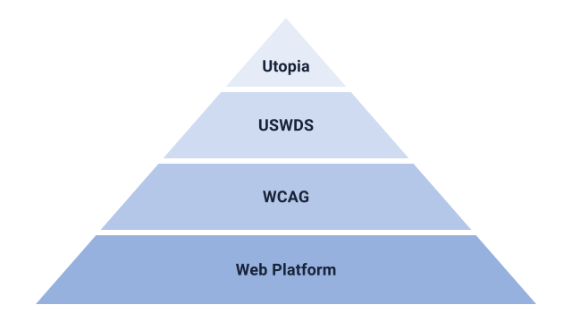

# Falkara Presentation

Falkara Presentation is an [Effect-based](https://effect.website/) TypeScript library for interface design. It derives each value from established standards and refuses any that would break them to keep the design consistent as it scales.

It has always nagged at us that most interfaces resize in jumps at breakpoints while every screen between them makes do. We tied every value to shared ratios so each one grows smoothly in step with the rest. Every screen gets values of its own, even the ones nobody designed for.

Decisions shift from numbers to intent. Everything that follows from that intent is worked out once and carries its reason with it, so none of it rests on anyone's taste. No value that would leave a reader behind ever reaches a screen. What remains is the part worth arguing about: how the interface should feel.

## Spotlight

Nothing shows the idea better than a fluid type scale. Three choices go in and out comes either a whole scale or a precise no for anything past the standards.

```ts
import { Effect } from 'effect';
import { Fluid, Fraction, Typography } from '@falkara/presentation';

// Intent: how sharply headings rise on narrow and wide screens, and how large body text gets.
const intent = {
  minimumFactor: Fraction.make(6n, 5n),
  maximumFactor: Fraction.make(5n, 4n),
  maximumBodyFontSize: Fraction.make(20n, 1n), // CSS pixels
};

Effect.gen(function* () {
  const steps = yield* Typography.scale(intent);
  return yield* Effect.forEach(steps, (step) => Fluid.clamp(step.minimumSize, step.maximumSize));
});
// Success: [
//   'clamp(0.8333rem, 0.7778rem + 0.2778vw, 1rem)',     position −1
//   'clamp(1rem, 0.9167rem + 0.4167vw, 1.25rem)',       position 0, body text
//   …
//   'clamp(2.986rem, 2.3919rem + 2.9706vw, 4.7684rem)', position 6
// ]

Typography.scale({ ...intent, maximumBodyFontSize: Fraction.make(30n, 1n) });
// Failure: SchemaError(Expected a body font size of at most 25.6 px, so that text can be enlarged
//   to 200 % within the 300 % page zoom of Safari, as WCAG 2.2 Resize Text requires
//   at ["maximumBodyFontSize"])
```

Without Effect the same call returns a plain value that reads right away.

```ts
const scale = Typography.scale(intent);

if (scale._tag === 'Success') {
  scale.value; // the steps
} else {
  scale.cause; // why it failed, with the SchemaError inside
}
```

## Modules

- **Typography** turns three choices into a fluid type scale where every step stays resizable.
- **Space** grows every gap with body text from that same intent.
- **Color** measures each pair against the size of the text it carries and finds the closest legible shade of a brand color.
- **Layout** holds lines to lengths that follow the font.

Viewport, Length, Fluid and Fraction hold the facts and the exact arithmetic the rest stands on.

## Groundwork

We build only on what the industry already agrees on and let a handful of them settle every decision that is not a matter of taste.



### Web Platform

Facts and opinions come built in. Only facts that hold for every reader in every browser are kept and opinions give way to derived values.

<picture>
  <source media="(prefers-color-scheme: dark)" srcset="../../.github/assets/baseline-widely-available-dark.svg">
  
</picture>

### WCAG

Promises to readers are on record. Values keep every promise within their reach and that goes well past what the European Accessibility Act in the EU and Section 508 of the Rehabilitation Act in the United States demand.

Falkara Presentation meets WCAG 2.2 at Level AAA in everything its values touch.

### USWDS

Conventions earn trust by surviving real use. Values borrow them only where the guidelines fall silent and only from the design system the United States government runs across nearly a hundred of its agencies.

### Utopia

Good models make hard things simple. Values follow Utopia for fluid type and space and hold it to every limit from the layers below.

## License

Falkara Presentation is licensed under [MIT](LICENSE).

Baseline logos by Google, licensed under [CC BY-ND 4.0](https://creativecommons.org/licenses/by-nd/4.0/).
